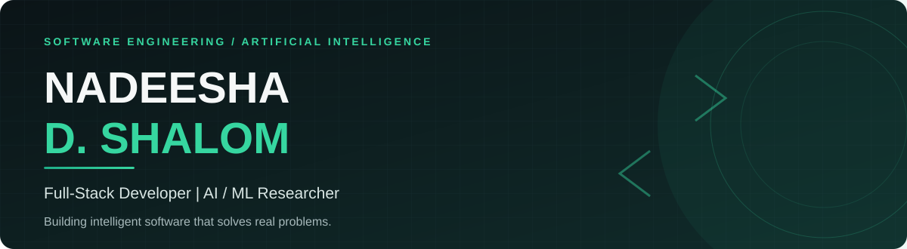
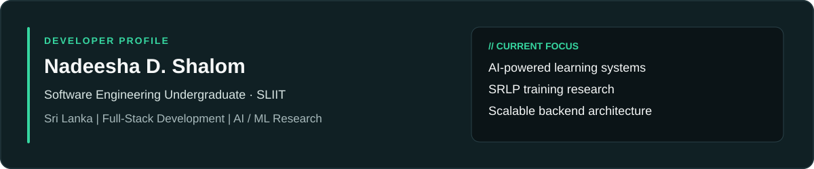

<div align="center">



<br />


<br />

[](https://www.linkedin.com/in/nadeesha-shalom-a5a2a4251)
[](https://github.com/Nadeesha-D-Shalom)
[](https://nadeesha-d-shalom.github.io/Nadeesha_UI.github.io)
[](https://medium.com/@nadeeshashalom1)
[](mailto:nadeeshashalom1@gmail.com)


</div>

## About Me



```python
class NadeeshaShalom:
    def __init__(self):
        self.name = "Nadeesha D. Shalom"
        self.role = "Software Engineering Undergraduate @ SLIIT"
        self.location = "Sri Lanka"
        self.email = "nadeeshashalom1@gmail.com"
        self.focus = ["Full-Stack Development", "AI/ML Research", "System Architecture"]
        self.currently = "Building an AI-powered LMS with Go, React & Python"
        self.researching = "Self-Regulating Learning Pressure (SRLP)"
        self.ask_me_about = ["Java", "Go", "Python", "Machine Learning", "REST APIs"]

    def philosophy(self):
        return "Build systems that are smart, scalable, and solve real problems."
```

## Tech Stack

| Category | Technologies |
|:--|:--|
| **Languages** | Java · Python · JavaScript · TypeScript · Go · PHP · C · SQL |
| **Frameworks & Platforms** | React · Spring Boot · Node.js · FastAPI · Gin · Tailwind CSS · Bootstrap |
| **AI & Machine Learning** | TensorFlow · PyTorch · Scikit-learn · Pandas · NumPy · OpenCV |
| **Databases & Cloud** | MySQL · Microsoft SQL Server · MongoDB · AWS |
| **Tools & IoT** | Git · Postman · Figma · Arduino · ESP32 |

## Featured Projects

<table>
<tr><td width="50%" valign="top">

### Student LMS with AI & ML
**2025–Present** · React, Go, FastAPI, MySQL, JWT, Ollama

Industry-grade learning management system featuring role-based authentication (Student, Teacher, Admin, IT-Admin), an LLM-powered academic assistant, modular microservices, and secure middleware validation.

</td><td width="50%" valign="top">

### Self-Regulating Learning Pressure (SRLP)
**2026** · Python, PyTorch, NumPy, Matplotlib

Experimental AI training-stability algorithm using adaptive loss-feedback pressure control and gradient-update regulation. Evaluated using convergence behavior, loss variance, and accuracy trends.

</td></tr>
<tr><td width="50%" valign="top">

### Diabetes Prediction — Logistic Regression
**2025** · Python, Scikit-learn, Pandas, Seaborn

Reported **83.45% accuracy** with class-imbalance handling, feature engineering, and evaluation using ROC-AUC, precision, recall, F1-score, and confusion matrix.

</td><td width="50%" valign="top">

### Airline Reservation System
**2025** · Java, Spring Boot, SQL Server, React, Tailwind

Flight search, booking, and cancellation with role-based authentication, Spring Data JPA, and an administrative dashboard for flights, passengers, and reservations.

</td></tr>
<tr><td width="50%" valign="top">

### TeaWeb — CEYMOS LANKA
**2025–2026** · React, PHP, MySQL, Bootstrap, Tailwind

Responsive tea and coconut export showcase hosted on GoDaddy, with an admin CRUD dashboard, image uploads, password recovery, and contact forms.

</td><td width="50%" valign="top">

### More Projects

Explore my additional software engineering, AI/ML, and IoT work.

[View all GitHub repositories](https://github.com/Nadeesha-D-Shalom?tab=repositories)

</td></tr>
</table>

## GitHub Analytics


<div align="center">


<br />


<br />


</div>

> Analytics depend on external services and public GitHub data; private activity and service availability may affect the results.

## Certifications & Education

| Qualification | Institution | Period |
|:--|:--|:--|
| AI/ML Engineer — Stage 1 & 2 | SLIIT | 2025 |
| Java OOP: Object-Oriented Programming | Udemy | 2025 |
| BSc (Hons) Software Engineering *(in progress)* | SLIIT | 2024–Present |
| Diploma in Software Engineering | Pioneer Institute | 2020–2022 |

## Achievements & Activities

- **Codefest 2025** — Participant, Innovative IoT Category, SLIIT.
- **Faculty of Computing Student Community (FCSC)** — Subcommittee Member, SLIIT (March 2025–Present).
- **15+ personal projects** — Java, Go, PHP, MySQL, AI/ML, IoT, and embedded systems.

## Connect

| Channel | Contact |
|:--|:--|
| Email | [nadeeshashalom1@gmail.com](mailto:nadeeshashalom1@gmail.com) |
| LinkedIn | [nadeesha-shalom-a5a2a4251](https://www.linkedin.com/in/nadeesha-shalom-a5a2a4251) |
| Portfolio | [Personal website](https://nadeesha-d-shalom.github.io/Nadeesha_UI.github.io) |
| Medium | [@nadeeshashalom1](https://medium.com/@nadeeshashalom1) |
| Phone | +94 70 7328800 |

<div align="center">

*"Build systems that are smart, scalable, and solve real problems."*


</div>
